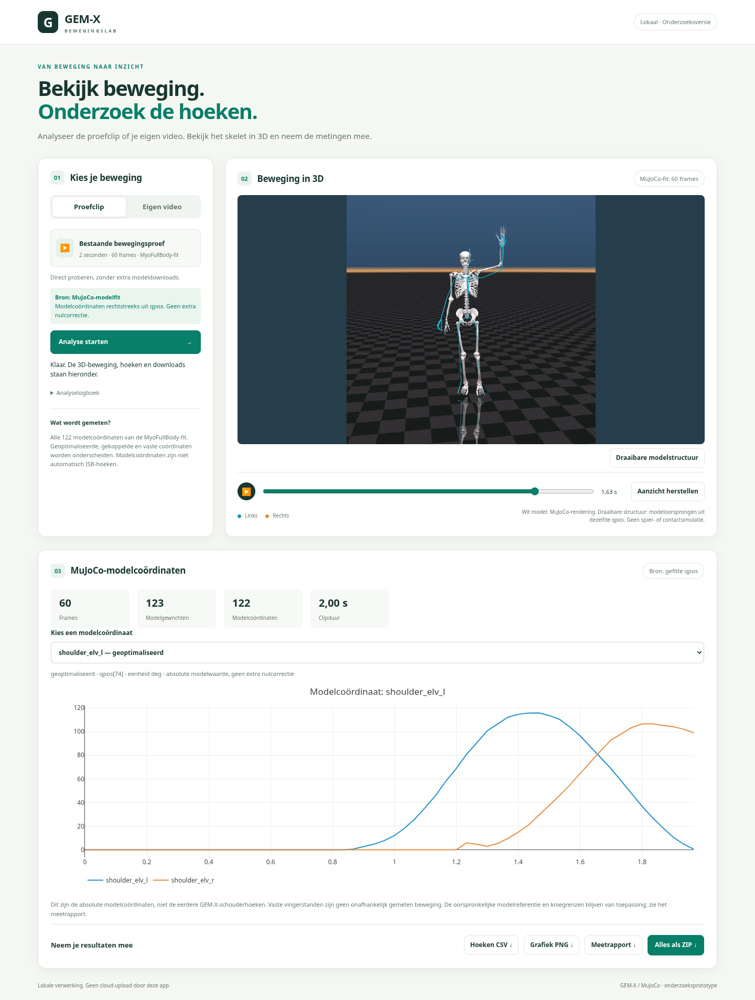

# Browserinterface voor de MyoFullBody-modelfit

**Bron van alle getoonde coördinaten en exports: de gefitte MuJoCo-`qpos` van het
witte MyoFullBody-model.** De app gebruikt hiervoor geen GEM-X-schouderhoeken of
extra beginwaarde-correctie.



De interface draait lokaal op je privécomputer. De berekeningen blijven op die
computer; er is geen hosting en geen openbare website.

## Windows starten

Open [Windows browser interface op GitHub Actions](https://github.com/jaapjansen1977/gemx/actions/workflows/browser-app.yml).
Gebruik een geslaagde build die deze MyoFullBody-wijziging bevat. Een eerder
gebouwde browser-EXE bevat nog de vorige gegevensbron. De nieuwe Windows-build
is niet vanuit de ontwikkelomgeving bevestigd.

1. Download **GEMXBrowser-Windows** bij Artifacts en pak alle ZIP-lagen uit.
2. Start `GEMXBrowser.exe` en laat de bijbehorende `_internal`-map staan.
3. De browser opent. Kies **Proefclip → Analyse starten**.
4. De witte modelvideo, modelcoördinaten en downloads verschijnen na controle.
5. Laat het servervenster open tijdens gebruik; sluit het daarna met Ctrl+C.

Het lokale adres is `http://127.0.0.1:8765`. Dat werkt alleen op de computer die
de server draait. Online gebruik vanaf werk vraagt een aparte hostingoplossing.

## Wat je krijgt

- De echte witte MuJoCo-rendering van de opgeslagen modelhouding, met de blauwe
  GEM-X-invoer als vergelijking in de video.
- Een apart draaibare structuur van **model-body-oorsprongen**, opnieuw uit
  dezelfde `qpos` berekend. Dit zijn geen huidmesh of gemeten anatomische punten.
- Een keuze uit alle **122 scalar-modelcoördinaten**: romp, schouder, elleboog,
  onderarm, pols, heup, knie, enkel/voet en overige modelcoördinaten.
- Grafieken van absolute modelwaarden en CSV/NPZ/rapport/ZIP-downloads.
- `qpos.csv` in de ZIP met alle 129 ruwe configuratiewaarden, inclusief de vrije
  roottranslatie en quaternion. Die rootwaarden zijn geen 129 gewrichtshoeken.

Er zijn **31 geoptimaliseerde**, **51 gekoppelde** en **40 vaste** scalar-
coördinaten. De rol staat bij iedere keus en in het rapport. Vaste vingerstanden
zijn geen onafhankelijk gemeten beweging. Gekoppelde coördinaten volgen de
originele modelvergelijkingen.

## Zeker weten waar de resultaten vandaan komen

`source` in het API-resultaat en meetrapport is `mujoco_myofullbody_fit`.
Het rapport bevat de modelcommit, de SHA256 van `fit.npz`, de `qpos`-index en
eenheid per coördinaat. Rotatiecoördinaten zijn uitsluitend van radialen naar
graden omgezet; schuifcoördinaten behouden meters. Er is **geen extra
nulcorrectie** toegepast.

Alle opgeslagen houdingen worden in MuJoCo opnieuw doorgerekend. De
body-posities moeten tot 1e-8 m bij de opgeslagen fit passen; alle modelgrenzen
en koppelingen worden opnieuw gecontroleerd. Een ongeldige of andere
gegevensbron wordt niet stilzwijgend als resultaat getoond.

Dit zijn modelcoördinaten, **geen automatisch ISB-gevalideerde anatomische
hoeken**. De bestaande fit legt de beginhouding op via een gekozen
modelreferentie en volgt daarna referentie-uitgelijnde GEM-X-segmentrotaties.
De knie-intervallen van circa 1,09–42,07° blijven van toepassing. Spierkrachten,
voetcontactoptimalisatie en klinische nauwkeurigheid worden niet aangetoond.

## Eigen video

De aparte GEM-X-videomotor zet eerst de video om naar segmentbeweging. Daarna
wordt **MyoFullBody opnieuw gefit**; de app exporteert uitsluitend de coördinaten
van die nieuwe fit en rendert het witte model. Als de fit of het model ontbreekt,
wordt de analyse niet vervangen door ruwe GEM-X-hoeken.

De motor moet MuJoCo 3.4.0 en de vastgelegde MyoSim-versie bevatten. Zie
[de desktopinstallatie](../desktop_app/README.md) en [de GEM-X-inrichting](../probe/README.md).
Modelgewichten en FFmpeg/ffprobe worden niet in de browser-EXE gebundeld. De
werkelijke Windows-video-inferentie is nog niet end-to-end gevalideerd.

```powershell
.\.venv-browser\Scripts\python.exe -m browser_app.server --open-browser `
  --engine-python 'C:\pad\videomotor\Scripts\python.exe' `
  --engine-config 'C:\pad\weights\body_video_native77.yaml' `
  --soma-assets 'C:\pad\assets\soma'
```

Ondersteund: MP4/MOV/AVI/MKV tot 256 MB en een selectie van maximaal 60 s.
Begin met 2 s; de oorspronkelijke CPU-video-inferentie kostte daarvoor circa
12 minuten, exclusief de extra modelfit en rendering.

## Starten met Python 3.12

Vanuit de repositoryroot:

```powershell
py -3.12 -m venv .venv-browser
.\.venv-browser\Scripts\python.exe -m pip install -r browser_app\requirements.txt
.\.venv-browser\Scripts\python.exe -m browser_app.server --open-browser
```

Git is nodig voor installatie van de exact vastgelegde MyoSim-versie. De volledige
Myosim-modelbestanden worden door het officiële pakket geleverd. De proefclip
vraagt geen GEM-X-gewichten of FFmpeg; de opgeslagen modelvideo is meegeleverd.

## Opslag en tests

Resultaten en eventuele invoervideo's blijven onder `GEMX-resultaten/browser`
in je gebruikersmap staan totdat je ze zelf verwijdert. Download de gewenste
resultaten voor een serverherstart; blijvende analysegeschiedenis ontbreekt nog.
De server luistert alleen lokaal en is niet bedoeld voor publieke poortforwarding.

```bash
python -m unittest myo_fit.test_export_results browser_app.test_server myo_fit.test_constraints -v
python -m browser_app.server --self-test outputs/nieuwe-model-browser-test
```

De tests vergelijken iedere geëxporteerde waarde rechtstreeks met de bron-qpos,
controleren replay, rollen en downloads, en wijzen een opzettelijk gewijzigde
modelhouding af. De Windows-build herhaalt de API-/exporttests en de zelftest in
de gebouwde EXE. Voor de optionele Chromium-controle: installeer Playwright en
gebruik `python -m browser_app.check_browser` terwijl de server draait.

### Diagnostiek van de gebouwde toepassing

De browser-EXE gebruikt expliciete paden naar de meegeleverde pagina's, scripts
en modeldata in `_internal`. Ook de daadwerkelijk met PyInstaller verpakte
Linux-toepassing heeft de volledige zelftest doorlopen; dit is afzonderlijk
vastgelegd in `evidence/linux-frozen-self-test.json`. De Windows-build blijft
een aparte controle.

Bij een mislukte Windows-zelftest worden stdout en stderr volledig in het
staplog getoond. Download zo nodig het artefact **GEMXBrowser-diagnostics**:
daarin staan de proceslogs en beschikbare PyInstaller-waarschuwingen. De build
blijft bij een fout falen; het bewaren van logs schakelt geen tests uit.
