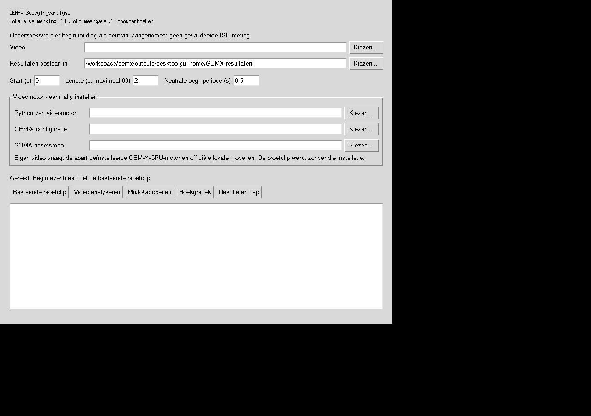

# GEM-X Windows-app: eerste onderzoeksversie

Deze versie brengt lokale videoanalyse, een MuJoCo-afspeelvenster en
schouderhoekexport samen. De broncode en Windows-build zijn toegevoegd;
**een geslaagde Windows-build en nieuwe Windows-videoanalyse zijn nog niet
bevestigd vanuit deze ontwikkelomgeving**. Dit is geen afgeronde installatie
voor willekeurige Windows-computers.



## Wat werkt en wat nog gecontroleerd moet worden

| Onderdeel | Stand |
|---|---|
| Appvenster en proefclip-knop | Op Linux daadwerkelijk geopend en bediend |
| CSV-/PNG-/NPZ-export op bestaande beweging | Uitgevoerd |
| Nulreferentie en aanvullende draaiingsmaat | Getest met bekende synthetische rotaties |
| MuJoCo-model van de bestaande 60 frames | Gevalideerd |
| Windows EXE | PyInstaller-build en Windows-runner ingericht; uitkomst nog onbevestigd |
| Nieuwe video via GEM-X-CPU-motor | Adapter aangesloten; niet end-to-end uitgevoerd op Windows |
| Witte MyoFullBody-fit, voetcontactoptimalisatie | Niet onderdeel van deze eerste appversie |
| Klinisch/anatomisch gevalideerde ISB-hoeken | Niet aangetoond |

## Windows-programma verkrijgen

Open [de Windows-build op GitHub Actions](https://github.com/jaapjansen1977/gemx/actions/workflows/windows-app.yml).
Na een geslaagde run staat onder **Artifacts** het bestand `GEMXDesktop-Windows`.
Download dat, pak beide ZIP-lagen volledig uit en open
`GEMXDesktop/GEMXDesktop.exe`. Laat de bijbehorende `_internal`-map staan: de EXE
gebruikt die voor Python, MuJoCo en de numerieke bibliotheken. Het programma vraagt
voor de bestaande proefclip geen apart geïnstalleerde Python of modelgewichten.

De workflow voert de numerieke tests uit, bouwt de EXE op Windows en laat die
zelf de proefbeweging analyseren en in MuJoCo valideren. Pas daarna wordt het
artefact aangeboden. De simpele venster-startcontrole komt daar aanvullend bij.
Een GitHub-account met toegang tot deze privé-repository kan nodig zijn voor
downloads. GitHub Actions moet voor de repository beschikbaar zijn.

## Gebruik

1. Begin met **Bestaande proefclip**. De app schrijft een nieuwe resultatenmap.
2. Kies **MuJoCo openen** voor de kinematische skeletweergave; dit is geen
   fysische simulatie met spierkrachten of geoptimaliseerd voetcontact.
3. **Hoekgrafiek** opent de grafiek; **Resultatenmap** geeft toegang tot CSV,
   NPZ en het rapport met de gebruikte referentie.
4. Voor eigen video's installeer je eerst de aparte videomotor, stel je diens
   Python, releaseconfiguratie en SOMA-assetsmap in en kies je een video.
   Start met twee seconden: de eerdere CPU-proef duurde circa twaalf minuten
   voor twee seconden beeld. De upstream-pipeline verwerkt maximaal 60 seconden
   per selectie; langere volledige video's zijn hier nog niet ondersteund.

De instellingen worden lokaal bewaard. De app uploadt geen videobeelden.
Het analyselogboek blijft in de resultatenmap. Afsluiten tijdens analyse stopt
de aangestuurde videomotor; onvoltooide resultaten worden niet als voltooid getoond.

## Eigen video: videomotor

De zware GEM-X-inferentie draait in een aparte Python-omgeving. De app bundelt
geen detector- of GEM-X-gewichten en geen FFmpeg-binary. Dit voorkomt ook dat
het lichte afspeelprogramma al de volledige inferentiestack moet laden.

Het meegeleverde `setup_engine_windows.ps1` is een eerste installatiescript voor
Python 3.12, de CPU-versie van PyTorch en GEM-X op de vastgelegde upstreamcommit.
Het vraagt een al geïnstalleerde Python 3.12 (64-bit), Git en internet voor
pakketten. De Windows-compatibiliteit van deze volledige stack moet nog worden
getest. Het script downloadt geen modelgewichten.

Gebruik de officiële lokale modelbestanden en releaseconfiguratie uit
[de bestaande installatiebeschrijving](../probe/README.md), inclusief de
vastgelegde modelrevisies. FFmpeg en ffprobe moeten op PATH beschikbaar zijn.
De eerder vastgelegde [modelvoorwaarden en distributievragen](../probe/LICENSE-REVIEW.md)
blijven van toepassing; de build bevat die gewichten niet. Modelbestanden en
video's worden niet stilzwijgend vervangen door een andere pose-pipeline.

## Betekenis van de hoeken

De eerste instelbare periode (standaard 0,5 seconde) wordt als neutrale
beginhouding aangenomen. De gemiddelde segmentoriëntatie wordt als één vaste
lokale correctie toegepast; er wordt geen scalar van elke elevatie afgetrokken.
De houding ten opzichte van zwaartekracht en anatomische landmarks is hiermee
niet onafhankelijk gemeten.

De grafiek toont:

- Gekalibreerde armheffing tegenover de borstkas.
- ISB-style YXY-axiale hoek, met lege stukken waar de ontbinding instabiel is.
- Een aanvullende **swing-twist**-maat rond de gekalibreerde bovenarm-Y-as.
  Dit is een andere definitie dan ISB-YXY-axiale rotatie; ze wordt apart benoemd.

De bestaande 3D-beweging voor MuJoCo blijft ongewijzigd. De referentiecorrectie
wordt op de hoekberekening toegepast; ze verplaatst niet de skeletpunten.
Het rapport vermeldt de gekozen referentie en alle beperkingen. Er worden nog
geen hoeken voor alle gewrichten geoptimaliseerd; deze versie richt zich op de
schouderanalyse die tot nu toe is onderzocht.

## Zelf starten en bouwen

Vanuit de repositoryroot:

```bash
python -m pip install -r desktop_app/requirements.txt
python -m desktop_app.app
python -m unittest desktop_app.test_analysis mujoco_demo.test_demo -v
python -m desktop_app.app --self-test outputs/nieuwe-desktop-zelftest
```

De `--self-test` schrijft een echte hoekexport en een 60-frame MuJoCo-validatie.
Op Windows met Python 3.12:

```powershell
powershell -File desktop_app/build_windows.ps1
```

Het resultaat is `dist/GEMXDesktop-Windows.zip`. Gebundelde distributienotices
staan naast het programma in `THIRD_PARTY_LICENSES`. De Windows-build is een
aparte stap; een succesvolle Linux-test is geen bewijs dat de EXE werkt.
