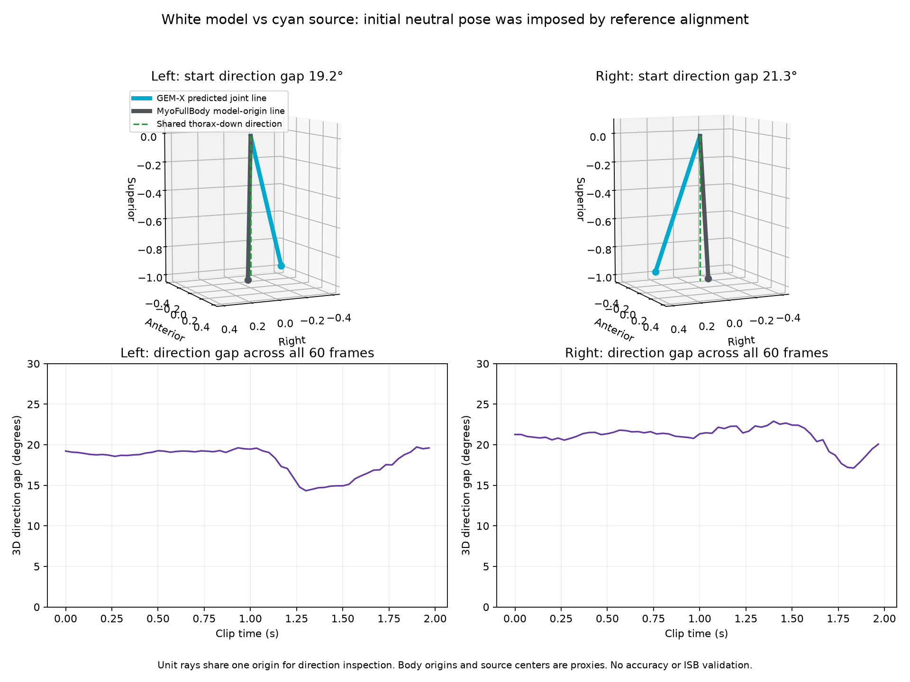

# Wit MyoFullBody-model tegenover blauwe GEM-X-lijnen



De waarneming dat beide bovenarmrichtingen circa 20° verschillen klopt voor de
opgeslagen fit. Dit is rechtstreeks op de opgeslagen 3D-posities gecontroleerd,
zonder het model opnieuw te fitten.

| Beginhouding, frame 0 | Links | Rechts |
|---|---:|---:|
| Ruimtelijk richtingsverschil wit/blauw | 19,22° | 21,26° |
| Blauwe GEM-X-bovenarmlijn t.o.v. borstkas-neerwaarts | 19,62° | 18,33° |
| Witte model-bovenarmlijn t.o.v. dezelfde borstkas-neerwaarts | 1,87° | 4,89° |
| Gemiddeld ruimtelijk richtingsverschil over alle 60 frames | 18,04° | 21,04° |

Het ruimtelijke richtingsverschil is de hoek tussen twee lijnen in 3D; het is
niet simpelweg het verschil tussen hun elevatiehoeken. Beide lijnen gebruiken
hier dezelfde GEM-X-borstkasreferentie. De witte lijn loopt van de oorsprong van
model-body `humerus_l/r` naar die van `ulna_l/r`; de blauwe van het voorspelde
`Arm`- naar `ForeArm`-centrum. Dit zijn model-/gewrichtsproxies, geen onafhankelijk
gevalideerde anatomische punten. De getallen zijn geen MyoSim-gewrichtscoördinaten
en geen gevalideerde ISB-hoeken.

## Waarom staat het witte model rechter?

De bestaande fit volgt veranderingen in segmentrotaties vanaf frame 0. De eerste
GEM-X-houding wordt via vaste lokale rotatie-offsets gekoppeld aan een gekozen,
haalbare referentiehouding van het standaard MyoFullBody-model. De fit probeert
dus niet de absolute beginhouding van de blauwe lijnen te reproduceren.

Dit is expliciet te zien in `RotationFit` in `myo_fit/fit.py`:
`offset = R_source(0).T @ R_model(reference)` en vervolgens
`target(t) = R_source(t) @ offset`. Op frame 0 is de doelrotatie daardoor per
definitie die van de gekozen modelreferentie. De opgeslagen `qpos` van frame 0
verschilt maximaal ongeveer 1e-10 van die referentie. Posities van schouder- en
elleboogcentra waren geen optimalisatiedoel; lichaamsmaten zijn standaardmodelmaten.

Het witte model lijkt bij de start dus vrijwel neutraal **door een aanname**.
Dat kan dichter bij de werkelijke rusthouding liggen, maar deze fit heeft dat
niet onafhankelijk uit de video vastgesteld. Dat het verschil door de clip
heen niet exact constant blijft, past ook bij de aanvullende modelkoppelingen,
optimizerafwegingen en het verschil tussen een segmentrotatie en een lijn tussen
modeloorsprongen.

## Is het witte model beter?

Een anatomisch model met vaste botlengtes en gewrichtsvoorwaarden kan een goede
basis zijn voor verdere verbetering. Het huidige resultaat toont echter nog
niet dat zijn bewegingshoeken nauwkeuriger zijn. Een anatomisch ogend skelet kan
ook een verkeerde pose aannemen; hier is de rechtere startstand ingebouwd.

Een logische volgende proef is een expliciet beoordeelde begin-/kalibratiehouding
met vaste anatomische definities. Vergelijk daarna op latere frames die niet
voor de kalibratie zijn gebruikt, en controleer zowel rotaties als vergelijkbare
schouder-/elleboogpunten. Gebruik een onafhankelijke referentie als je wilt
vaststellen welke methode werkelijk nauwkeuriger is. Alleen de modelbeginhoek
als waarheid nemen, zou de aanname juist onzichtbaar maken.

## Reproduceren

Vanuit de repositoryroot, met NumPy, SciPy en Matplotlib (geen MyoSim-installatie
of nieuwe fit vereist):

```bash
MPLCONFIGDIR=/workspace/.cache/matplotlib .venv-mujoco/bin/python -m myo_fit.compare_arm_directions --output outputs/nieuwe-armrichtingcontrole
```

De uitvoermap moet nieuw zijn. Uitvoer: `comparison.png`, `directions.npz` en
[report.json](report.json), inclusief invoerhashes en alle meetdefinities.
