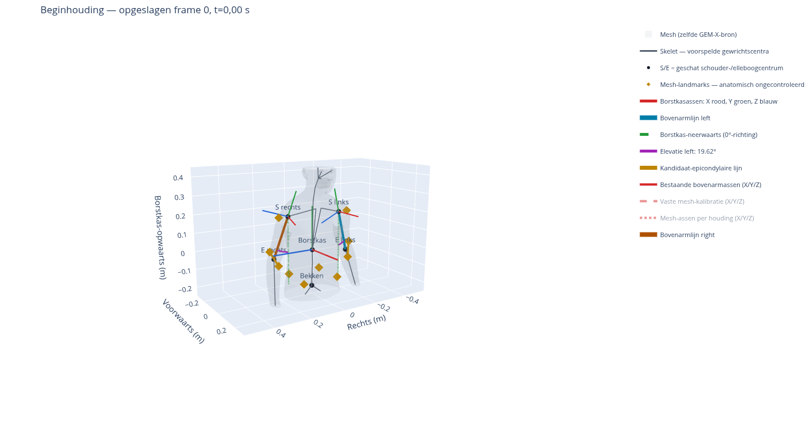

# Controleerbare 3D-kalibratievisualisatie

[Bekijk alle vaste aanzichten](start-views.png) · [Modelreferentie](reference-views.png) · [Download de draaibare viewer](https://github.com/jaapjansen1977/gemx/raw/refs/heads/main/shoulder/results/calibration-3d/calibration.html)

De drie ruimterichtingen gebruiken dezelfde lengteschaal, ook bij het wisselen
tussen schouderzoom en het hele lichaam.

De viewer is één zelfstandig HTML-bestand van circa 7 MB. Download het bestand
en open het met een desktopbrowser zoals Chrome, Edge of Firefox. Op GitHub zelf
wordt HTML niet als interactieve pagina uitgevoerd. Gebruik daar de downloadknop
(**Download raw file**). Een browser met WebGL is nodig; een server of
internetverbinding is na het downloaden niet nodig.



## Wat je ziet

- **S en E:** geschatte schouder- en elleboogcentra. S is een GH-proxy, geen
  gecontroleerd centrum van de schouderkop. Het acromion wordt niet als GH gebruikt.
- **Grijs:** de opgeslagen SOMA MID-mesh en het geschatte skelet.
- **Geel:** de bestaande 18 mesh-landmarks en de lijnen tussen de kandidaat-
  elleboogepicondylen. Deze punten zijn anatomisch nog niet gecontroleerd.
- **Rood/groen/blauw:** lokale X/Y/Z-assen. Bij de borstkas staan deze voor
  voorwaarts/opwaarts/rechts; bij de bovenarm bepalen ze de lokale oriëntatie.
- **Groene stippellijn vanaf iedere schouder:** neerwaarts volgens de borstkas;
  dit is de 0°-richting voor elevatie. Het is geen gemeten zwaartekrachtlijn.
- **Paarse boog:** de ruimtelijke hoek tussen de groene stippellijn en de
  geschatte schouder–ellebooglijn. Projecties kunnen een andere hoek tonen;
  de gerapporteerde waarde wordt in 3D berekend.

Standaard toont de viewer de schouders in de beginhouding. Je kunt draaien,
zoomen, vaste aanzichten kiezen en overschakelen naar het hele lichaam.
In de legenda kun je de mesh en assen aan- en uitzetten. De bestaande
bovenarmassen zijn aanvankelijk zichtbaar; de vaste mesh-kalibratie en de
mesh-assen per houding kun je apart inschakelen. Vergelijk bij voorkeur één
assenmethode tegelijk, zodat overlappende pijlen niet verwarren.

Met de houdingskeuze wissel je tussen **frame 0 van de video** en de
**modelreferentie in T-pose**. De T-pose is een synthetische modelhouding met
de opgeslagen vorm van frame 0, geen waargenomen anatomische nulhouding. Iedere
houding wordt via één starre transformatie in zijn eigen borstkasbasis getoond.
Geen enkel gewricht of mesh-punt wordt daarvoor afzonderlijk verschoven.

## Wat deze controle vaststelt

| Controle beginhouding | Links | Rechts |
|---|---:|---:|
| Elevatie uit de getekende schouder–ellebooglijn | 19,62° | 18,33° |
| Verschil met de bestaande assenberekening | <0,00002° | <0,00002° |
| Hoek kandidaat-ellebooglijn met kandidaat-bovenarmlengteas | 45,43° | 50,79° |

De niet-nul beginhoek zit al in de opgeslagen 3D-geometrie ten opzichte van de
voorlopige borstkas. De geometrische hoek en de bestaande assenberekening zijn
vrijwel gelijk. Dit bewijst niet dat de geschatte lichaamsstand anatomisch juist
is. Ook de gemarkeerde ellebooglijn is niet automatisch een goede botas doordat
er een numerieke oriëntatie uit kan worden berekend.

De mesh-landmarks zijn opnieuw geëvalueerd op hun exacte opgeslagen driehoeken
met de opgeslagen barycentrische gewichten. Het maximale verschil met de
opgeslagen frame-0-punten is **0 m**. Beide houdingen gebruiken de volledige
mesh: 18.056 vertices en 36.108 driehoeken; er is geen mesh-vereenvoudiging.

## Waar je bij het beoordelen op kunt letten

1. Vergelijk de beginhouding met het [eerste beeld van de bestaande overlay](../check-000.jpg).
   Liggen de geschatte S- en E-centra op aannemelijke plaatsen? De video toont
   een projectie; een diepteafwijking kan daarin moeilijk zichtbaar zijn.
2. Bekijk de bovenarmen van voren én van opzij. In welke richting wijkt hun lijn
   af van de groene neerwaartse borstkasrichting?
3. Schakel de grijze mesh uit om de centra en assen vrij te zien. Schakel de mesh
   weer in om de geel gemarkeerde elleboogpunten te beoordelen.
4. Controleer de punten ook in de T-pose. De namen 'mediaal' en 'lateraal' zijn
   voorlopig; hun ligging moet bij de botuitsteeksels passen. Punten mogen niet
   alleen op grond van een gunstig hoekverloop worden verplaatst.

Deze visualisatie levert nog geen objectief gecorrigeerde anatomische kalibratie.
IJ/C7/PX/T8-borstkaslandmarks en een onafhankelijk bepaalde GH-kalibratie ontbreken.
De beginhouding gebruikt de eerdere XLO-gewrichtscentra en een MID-mesh; het
bestaande mesh-rapport beschrijft een verschil tot circa 1,02 mm. Beide zijn van
dezelfde GEM-X-voorspelling afgeleid. De meting blijft humerothoracaal, zonder
onafhankelijke schouderbladmeting.

## Reproduceren en controle

Vanaf de repositoryroot, met Python 3.12:

```bash
.venv-mujoco/bin/python -m pip install -r shoulder/requirements-calibration.txt
XDG_CACHE_HOME=/workspace/.cache MPLCONFIGDIR=/workspace/.cache/matplotlib \
  .venv-mujoco/bin/python -m shoulder.visualize_calibration --output outputs/nieuwe-kalibratievisualisatie
.venv-mujoco/bin/python -m unittest shoulder.test_visualize_calibration shoulder.test_compare_mesh shoulder.test_angles landmarks.test_geometry -v
```

De uitvoermap moet nieuw zijn. Het script schrijft de HTML-viewer, twee PNG's en
`audit.json`. [Het auditrapport](audit.json) bevat de geometrische controles,
inputhashes en de hash van het script. Dertien tests slagen, waaronder bekende
hoeken, behoud van afstanden en rechtshandigheid, en correcte boogeindpunten.

De interactieve viewer is ook getest in Chromium: wisselen van houding,
mesh-assen aan/uit, vier camerastanden, hele-lichaam-/schouderzoom en muisrotatie.
Geen JavaScript-fouten of externe HTTP(S)-verzoeken zijn waargenomen. Zie
[browsercontrole](browser-validation.json).

De browsercontrole en het voorbeeldbeeld kunnen met de optionele afhankelijkheid
`playwright==1.64.1` en een aanwezige Chromium-browser opnieuw worden gemaakt:

```bash
.venv-mujoco/bin/python -m shoulder.check_calibration_viewer \
  --html outputs/nieuwe-kalibratievisualisatie/calibration.html \
  --report outputs/nieuwe-kalibratievisualisatie/browser-validation.json \
  --screenshot outputs/nieuwe-kalibratievisualisatie/interactive-preview.png
```
