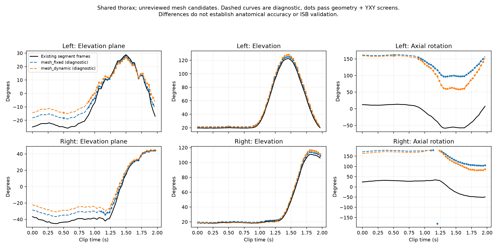

# Vergelijking schouderkinematica: bestaande assen en mesh-landmarks

Dezelfde opgeslagen clip en dezelfde borstkasassen; geen nieuwe GEM-X-inferentie. Alle uitkomsten zijn diagnostisch, met ongecontroleerde anatomische mesh-punten.



## Bewegingsuitslagen over gelijke tijdvensters

Elke rij gebruikt binnen dezelfde kant exact hetzelfde aaneengesloten tijdvenster voor alle methoden. De linker- en rechtervensters verschillen. Dit zijn clipuitslagen, geen maximale persoonlijke ROM.

| Kant | Tijdvenster (s) | Methode | Elevatievlak | Elevatie | Axiaal |
|---|---|---|---:|---:|---:|
| Links | 0.90–1.93 | Bestaande segmentassen | 44.8° | 102.2° | 63.1° |
| Links | 0.90–1.93 | Vaste mesh-kalibratie | 38.2° | 103.0° | 58.1° |
| Links | 0.90–1.93 | Mesh per frame | 32.8° | 106.3° | 91.1° |
| Rechts | 1.23–1.97 | Bestaande segmentassen | 83.7° | 89.7° | 82.9° |
| Rechts | 1.23–1.97 | Vaste mesh-kalibratie | 75.5° | 91.7° | 75.8° |
| Rechts | 1.23–1.97 | Mesh per frame | 71.7° | 96.3° | 96.8° |

## Interpretatie

De axiale nulstand verschilt sterk tussen de definities. Absolute axiale hoekverschillen mogen niet als extra lichaamsrotatie worden gelezen. Zelfs na het vergelijken van uitslagen over hetzelfde tijdvenster blijft de dynamische mesh-methode duidelijk afwijken. Dat kan door landmarkplaatsing, meshvervorming en verschillen in assendefinitie komen; deze proef stelt de oorzaak niet afzonderlijk vast.

De neutrale kandidaat-epicondylaire lijn maakt circa 40° met de bovenarmlengteas. De projectie is numeriek berekenbaar, maar de anatomische plaatsing blijft ongecontroleerd. De punten komen uit dezelfde GEM-X-bron en leveren geen onafhankelijke ground truth.

De volgende stap richting ISB is het controleren van de epicondylen en GH-kalibratie, plus het toevoegen van onderbouwde IJ/C7/PX/T8-borstkaslandmarks. Deze proef meet humerothoracale beweging en bevat geen scapulametingen.

## Bestanden

- [Grafiek](comparison.png) en [SVG](comparison.svg)
- [Alle framewaarden](comparison.csv)
- [Volledig rapport met invoerhashes](report.json)

Negen tests slagen: bilaterale assen, rotatie/translatie-invariantie, degeneratie, hoekgrensovergangen, bestaande YXY-reconstructie en barycentrische geometrie.

## Waarom begint elevatie niet op nul?

| Controle | Links | Rechts |
|---|---:|---:|
| Elevatie eerste frame, bestaande analyse | 19,62° | 18,33° |
| Rechtstreeks uit de voorspelde schouder–ellebooglijn | 19,62° | 18,33° |
| Gemiddelde over 0–0,5 s | 19,58° | 18,48° |
| Standaardafwijking over 0–0,5 s | 0,17° | 0,43° |

De elevatie is de hoek tussen de neerwaartse bovenarmlijn en de negatieve
superior-as van de geschatte borstkas. Volledig neerwaarts langs die borstkasas
zou 0° geven. Stilstand betekent alleen dat de hoek weinig verandert.
Er is geen gemeten anatomische nulhouding ingesteld en het eerste videoframe
is niet van de hoeken afgetrokken.

De directe 3D-geometrie en de Eulerberekening verschillen over de hele clip
minder dan 0,00004°. Dit sluit een afzonderlijke Euler-rekenfout als verklaring
voor de startoffset uit, maar valideert de 3D-geometrie of anatomische assen niet.
In het model heeft de schouder–ellebooglijn in het eerste frame zowel een
laterale als een posterieure component ten opzichte van de proxy-borstkas.

Op het [eerste videobeeld](../check-000.jpg) lijkt de houding vrijwel neutraal.
Een 2D-beeld bepaalt de 3D-hoek niet exact. Deze circa 18–20° mag daarom niet
zonder meer als de werkelijke anatomische elevatie worden beschouwd. Mogelijke
bijdragen zijn de werkelijke rusthouding, fouten in de monoculaire 3D-schatting
en de voorlopige borstkasdefinitie. Deze proef scheidt die bijdragen niet.

Voor een ISB-meting is de volgende controle een anatomisch onderbouwde
borstkas-/bovenarmkalibratie en beoordeling van de voorspelde schouder- en
elleboogcentra. Alleen de beginwaarde aftrekken geeft een relatieve verandering
vanaf de starthouding; het herstelt geen foutieve 3D-assen en maakt de uitkomst
niet ISB-conform. Bij elevatie rond nul zijn bovendien elevatievlak en axiale
rotatie in de YXY-ontbinding niet afzonderlijk identificeerbaar.

## Reproduceren

Vanaf de repositoryroot, met NumPy en Matplotlib geïnstalleerd:

```bash
MPLCONFIGDIR=/workspace/.cache/matplotlib .venv-mujoco/bin/python -m shoulder.compare_mesh --output outputs/nieuwe-mesh-vergelijking
```

De uitvoermap moet nieuw zijn. `report.json` bevat naast de vergelijking ook
`starting_posture_audit` per kant en hashes van alle invoer en het script.
